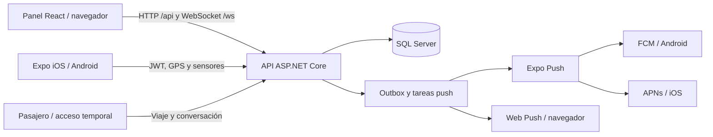

# Transportes Eunice

Sistema de operaciones de transporte con API en .NET, panel web en React y aplicación móvil en Expo para iOS y Android. Integra viajes, flota, telemetría GPS, alertas, comunicación y notificaciones.

Este repositorio publica una copia del código fuente con historial nuevo. La configuración de producción, credenciales, bases de datos, paquetes del VPS, APK e IPA se mantienen fuera del repositorio. Para ejecutar una instalación propia hay que proporcionar sus servicios y configuración.

## Funciones

- Administración de usuarios, perfiles y permisos; autobuses, rutas y asignaciones de viajes.
- Seguimiento en vivo mediante HTTP y WebSocket, selección de la fuente de ubicación y recuperación de telemetría pendiente.
- Alertas de conducción, evaluación mensual de pilotos y cálculo de desempeño.
- Chat interno y atención a pasajeros mediante accesos públicos temporales al viaje.
- Push móvil con Expo, FCM en Android y APNs en iOS; notificaciones web para conversaciones de pasajeros.
- Eliminación de cuenta con anonimización del registro, cierre de sesiones y retiro del usuario de los listados operativos; se conservan referencias históricas necesarias.

## Estructura

| Carpeta | Contenido |
| --- | --- |
| `AccesoDatos/AccesoDatos/` | Modelos y contexto de Entity Framework Core. |
| `AccesoDatos/webapi/` | API ASP.NET Core, permisos, WebSocket, SQL y procesamiento de notificaciones. |
| `AccesoDatos/webapi.Tests/` | Pruebas de servicios y regresión, más integración opcional con SQL Server local. |
| `frontend/frontendgarma/` | Panel web React/Vite y seguimiento público de viajes. |
| `mobileapp/` | Aplicación Expo/React Native, navegación, sensores, almacenamiento y push. |
| `docs/` | Instalación, arquitectura, notificaciones, pruebas y despliegue. |
| `scripts/` | Comprobaciones del contenido que se publica. |

## Tecnologías y requisitos

| Componente | Versión utilizada por el código |
| --- | --- |
| Backend | .NET 10, ASP.NET Core, Entity Framework Core 10. |
| Base de datos | **Microsoft SQL Server**; LocalDB para desarrollo en Windows. |
| Web | React 19, TypeScript 6, Vite 8. |
| Móvil | Expo SDK 57, React Native 0.86, React 19. |
| JavaScript | Node.js 24 y npm; usar los `package-lock.json` incluidos. |

La base de datos no es PostgreSQL. No hay un instalador Docker incluido. Para generar binarios móviles de tienda se necesitan cuentas propias de Expo, Apple y/o Google, según la plataforma.

## Primeros pasos

```bash
git clone https://github.com/fuck-jhus/transportes-eunice.git
cd transportes-eunice
```

1. Sigue [Instalación y configuración](docs/INSTALACION.md) para preparar SQL Server, la API y ambos clientes.
2. Consulta [Notificaciones](docs/NOTIFICACIONES.md) para conectar tu propio proyecto Expo/Firebase y tus credenciales APNs.
3. Ejecuta las comprobaciones de [Pruebas](docs/PRUEBAS.md).
4. Para producción, sigue [Despliegue en VPS](docs/DESPLIEGUE.md); las migraciones se aplican con la API detenida.

Los archivos `.env.example` y `appsettings.example.json` contienen únicamente plantillas. No tienen acceso al entorno real. La app móvil usa un destino deliberadamente inválido hasta configurar `EXPO_PUBLIC_API_URL`.

## Arquitectura



Los límites entre módulos y las decisiones sobre sesiones, datos y notificaciones están descritos en [Arquitectura](docs/ARQUITECTURA.md).

## Seguridad, estado y uso

La publicación se revisa por lista de archivos permitidos, patrones de secretos y exclusiones de configuración privada. Incluye una comprobación automática para futuras contribuciones; no sustituye una auditoría completa ni demuestra el funcionamiento del servidor, de los proveedores push o de los dispositivos físicos. Consulta [SECURITY.md](SECURITY.md).

El repositorio incluye código y pruebas, pero no una demostración pública con usuarios o contraseñas compartidos. Los datos usados en las pruebas son sintéticos. No se ha especificado una licencia general para el código del proyecto. Las dependencias conservan sus propias licencias; consulta [Avisos de terceros](THIRD_PARTY_NOTICES.md).

Para proponer cambios, consulta [CONTRIBUTING.md](CONTRIBUTING.md).
